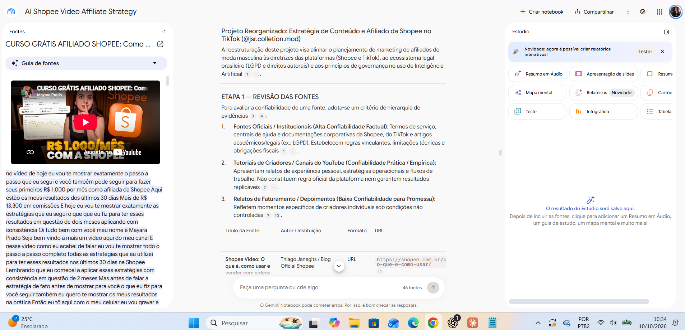

# IA para marketing de moda masculina

Projeto de estudo com NotebookLM sobre criação de conteúdo para o TikTok no contexto de um afiliado da Shopee.

## Tema e objetivo

Aprender a usar IA para planejar conteúdos de moda masculina no TikTok, criar roteiros e interpretar métricas como afiliado da Shopee, com base em fontes selecionadas e revisão humana.

O caso de aplicação é o perfil [@jsr.colletion.mod](https://www.tiktok.com/@jsr.colletion.mod). O perfil é novo e ainda não possui resultados consolidados. Este projeto documenta o estudo e o planejamento, sem apresentar vendas ou eficácia comprovada das estratégias.

## Fontes

A interface do notebook registra 46 fontes. Os links abaixo foram fornecidos durante a seleção inicial de vídeos; a correspondência entre links, títulos e autores ainda precisa ser conferida.

- https://www.youtube.com/watch?v=0yVxN6kutVg
- https://www.youtube.com/watch?v=5U5VVQJDtyQ
- https://www.youtube.com/watch?v=EsesSfF9MPE
- https://www.youtube.com/watch?v=ybeQCi8Fme0
- https://www.youtube.com/watch?v=zTvbRgN41w8

O notebook também inclui textos e um PDF, conforme a documentação gerada. A lista final de fontes em texto, seus links exatos e justificativas individuais ainda está pendente de conferência.

Critérios de seleção: autoria identificável, relação com o objetivo, atualidade e evidências. Documentação oficial será priorizada para regras das plataformas; tutoriais serão tratados como experiências e sugestões, sem garantia de resultados.

## Diretriz de comportamento

> Atue como meu tutor de IA aplicada ao marketing de afiliados da Shopee no TikTok, com foco em moda masculina. Responda usando as fontes selecionadas e cite as evidências. Diferencie fatos, opiniões, relatos pessoais e hipóteses. Não invente características, preços, descontos ou resultados. Diferencie TikTok, TikTok Shop e Shopee Vídeo. Informe quando faltar evidência e preserve a fidelidade ao produto. Todo conteúdo será revisado por uma pessoa antes da publicação.

## Perguntas e aprendizados

### Como avaliar a confiabilidade das fontes?

O notebook organizou as fontes em documentos institucionais, tutoriais e relatos pessoais. A consulta à transcrição de um vídeo de Mayara Prado mostrou a autora descrevendo seu próprio método e resultados. Isso permite reconhecer um relato pessoal, mas não comprova que a estratégia produzirá o mesmo resultado para a JSR.

Fonte exibida: “CURSO GRÁTIS AFILIADO SHOPEE: Como ...”, de Mayara Prado. O título completo e a URL estão pendentes de confirmação. [Resposta e fonte aberta](evidencias/04-citacao-fonte-aberta.png).

### Como adaptar orientações entre plataformas?

A revisão solicitou separar as regras da Shopee Vídeo das práticas para o TikTok. A adaptação de duração e estrutura de roteiro será tratada como hipótese para testar, e não regra universal. [Registro da revisão](evidencias/02-revisao-critica.png).

### Como acompanhar os resultados de um perfil novo?

Será elaborado um plano para observar visualizações, interações e retenção disponíveis no TikTok, além de cliques, pedidos e comissões disponíveis na Shopee. Os indicadores serão conferidos nos painéis. Cliques e vendas não serão atribuídos a um vídeo específico sem rastreamento que sustente essa associação. A resposta de estudo com fontes para esta pergunta ainda precisa ser documentada.

## Evidências

Veja a [descrição das capturas](evidencias/README.md), com os limites de cada registro.

Os registros mostram o processo de revisão e uma fonte aberta. Não representam resultados comerciais. Dois prints enviados apresentam o mesmo conteúdo e foram preservados como registros repetidos.

## Materiais de estudo

Mapa mental e guia de estudos ou apresentação: ainda não gerados e adicionados a este repositório.

## Notebook compartilhado

Link pendente. O acesso por outra pessoa ainda precisa ser testado.

## Pendências antes da submissão

- [ ] Conferir os títulos, autores e links das fontes selecionadas e explicar a escolha de cada uma.
- [ ] Documentar respostas de estudo com referências identificáveis e capturas das citações abertas.
- [ ] Gerar, baixar e adicionar os materiais do Estúdio.
- [ ] Inserir o link compartilhado do notebook e testar o acesso.
- [ ] Confirmar que nenhum arquivo contém dados pessoais ou conteúdo sem autorização de compartilhamento.
- [ ] Publicar o repositório na conta do autor com visibilidade pública.

Este repositório é um trabalho em andamento. As pendências são explícitas para evitar apresentar como verificado o que ainda não foi conferido.
