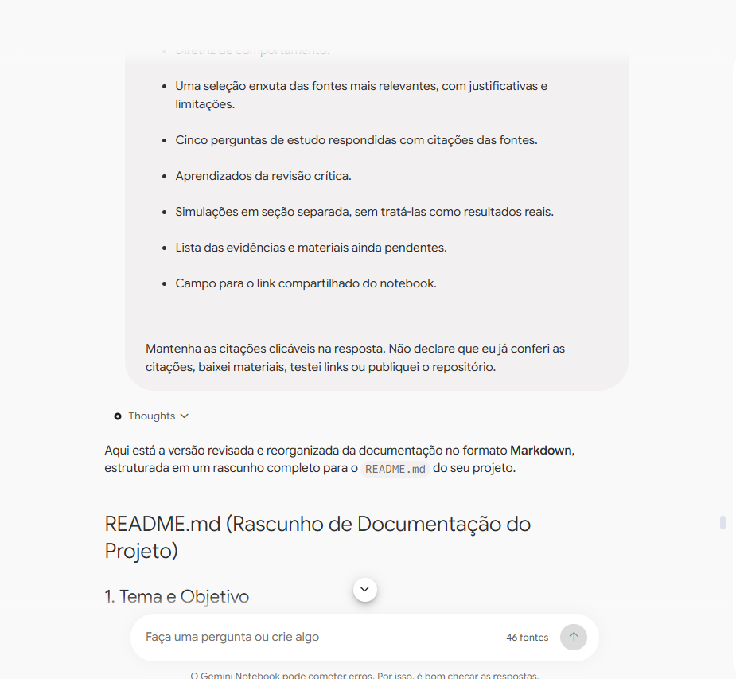
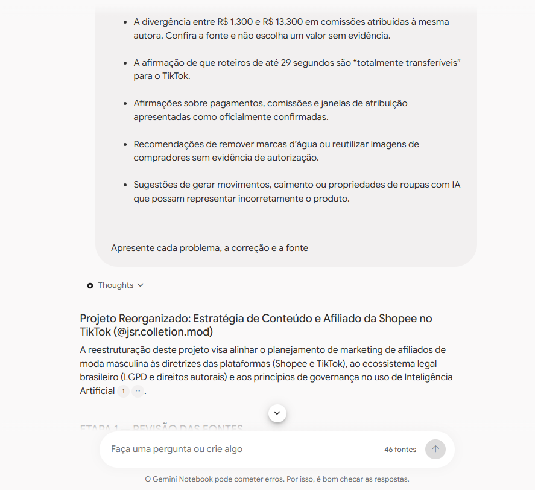

# Evidências do processo de estudo

Os registros abaixo mostram a interação com o notebook e a revisão da documentação. O perfil do projeto é novo; estes prints não representam resultados de vendas ou desempenho de campanhas.

## 1. Organização da documentação

Mostra instruções para organizar fontes, perguntas, aprendizados e pendências, além do início da resposta em formato de README. A interface indica 46 fontes. Não mostra uma citação aberta.

## 2. Revisão crítica das respostas

Mostra o pedido para revisar valores divergentes, adaptações entre plataformas e uso de imagens, seguido pelo início da resposta com um marcador de citação visível. O trecho original da fonte não está aberto; o registro não comprova que a citação foi conferida.

## 3. Registro adicional da revisão

Apresenta o mesmo conteúdo visível do segundo print. Foi preservado conforme enviado, mas não constitui uma terceira evidência distinta.

## 4. Resposta com fonte aberta

Mostra a resposta sobre classificação das fontes e, ao lado, a transcrição destacada do vídeo de Mayara Prado, identificado na interface como “CURSO GRÁTIS AFILIADO SHOPEE: Como ...”. O trecho apresenta a autora descrevendo seu próprio processo e resultados. Sustenta a identificação da fonte como relato pessoal, mas não comprova a eficácia geral do método nem garante resultados para o perfil JSR. Os valores transcritos não foram conferidos no áudio original.

## Limites da verificação

A captura demonstra a consulta ao trecho associado à resposta. A afirmação de que resultados não são garantidos é uma avaliação crítica do projeto, e não uma declaração explícita no trecho visível. Regras de plataformas e informações financeiras ainda exigem conferência específica nas respectivas fontes.
